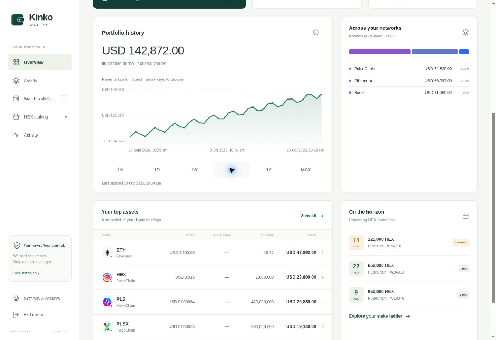
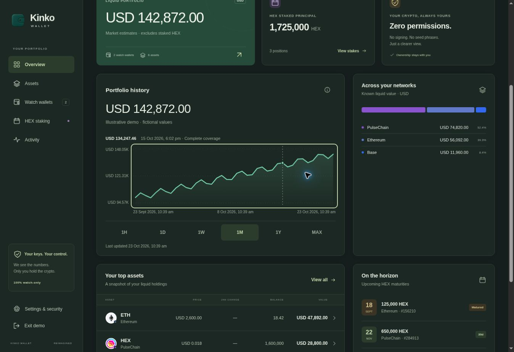

# Owner review

- Branch: **feature/portfolio-history-verified**
- Draft PR: https://github.com/brownie-au/kinko-wallet/pull/3 — exact final commit pinned in its description.
- Non-production Preview: https://kinko-wallet-v2-test-git-feature-por-3fd008-rob-browns-projects.vercel.app/
- Expected release asset: **index-tob7D-uI.js**, CSS index-B_XjISHs.css.
- Validation: **114 tests passed**, build passed; cached chart restore 60.4ms in final Node/JSDOM suite with providers pending.

The chart is implemented, including all six ranges, comparable interval value changes, sparse points, gaps, keyboard/pointer inspection, both themes, encrypted persistence, migration, compression, long-term retention and encrypted backups. Background backfill uses actual historical balances and historical prices. Deployed API checks verified partial native/wrapped subsets on **Base and PulseChain at 28 July 2024**, using the explicitly labelled public repository fixture, not owner holdings.

Remaining partial: ETH/Polygon/BNB archive access, complete previously sold token discovery, HEX/protocol position history, wider asset-specific price coverage and public/commercial provider redistribution rights. **360px layout, physical finger drag and mobile screenshots remain unverified** because the available browser has no supported viewport/device control. No mobile screenshot is fabricated. Owner browser close/relaunch on a representative real watchlist is also outstanding; persistence is integration-tested using authenticated storage and remounts.

Read [coverage](COVERAGE.md), [implementation notes](IMPLEMENTATION.md) and [acceptance verification](VERIFICATION.md). Exact test/build logs and live responses are included alongside them. Main-chart engineering detail stays behind the information control.

Screenshots below are **fictional illustrative demo values**. They verify presentation, not complete historical holdings. Their common layout and colours match the final source; later changes only tightened storage/provenance and selected-range timestamp-quality handling.

Production was not merged, promoted, rebound to another domain or otherwise changed by these actions. Existing user history was not deleted. No paid service, key purchase, plan upgrade or billing change was introduced.
